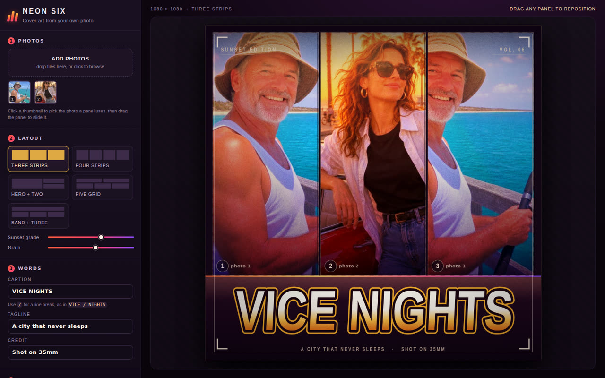

[](https://make.fun/bounty/gta6-cover-art-01?utm_source=github&utm_medium=readme&utm_campaign=gta6-cover-art-01)
[](https://make.fun/bounty/gta6-cover-art-01/leaderboard?utm_source=github&utm_medium=readme&utm_campaign=gta6-cover-art-01)
[](https://make.fun/bounty/gta6-cover-art-01?utm_source=github&utm_medium=readme&utm_campaign=gta6-cover-art-01)

# Neon Six — cover art from your own photo

Drop in a photo of yourself. Get back a sunset-collage cover: three, four or five panels of the
same frame at different crops, graded to dusk, with your caption set as flush-width poster
lettering across the bottom. Export it as a PNG at 1080×1080, 1080×1350 or 1920×1080.

Everything runs in the browser. No build step, no server, no network calls — open `app/index.html`
and it works, offline.



## The three-way loop

1. **Load** one or more photos (drag onto the panel tray, or click to browse). One photo is enough:
   the app spreads it across every panel with a different crop on each.
2. **Tweak** — pick a layout, click a panel, drag it to slide the crop, use the zoom slider. Two
   faders set the sunset grade and the film grain.
3. **Export** — one click, `canvas.toBlob`, a PNG lands in your downloads.

Screenshot mode is built in, for reproducible captures: `?shot=cover&photos=pier&caption=NEON` paints
the sheet alone, full-window. `?shot=editor` paints the studio with the rail in sync.

## How the collage is built

Four layouts, all authored in a unit square so the same table drives every output size:

| Layout | Panels |
| --- | --- |
| Three Strips | the classic — three tall panels side by side |
| Four Strips | four narrow panels, the gig-poster look |
| Hero + Two | one big portrait panel, two stacked beside it |
| Five Grid | two across the top, three below |

Every panel holds a *slot*: which photo, a focus point inside the photo's slack, and a zoom. The
zoom is a multiplier on the cover-fit scale, so a photo never leaves a gap at the edges no matter
how it is dragged.

## The grade

Each panel is drawn with `saturate(1.62) contrast(1.22)`, then painted over with a vertical sunset
ramp in `overlay` mode — burnt orange at the crown, weak rose through the middle (that is where the
face is, and skin has to stay skin), plum at the foot. A screen-mode sun bloom sits high in the
frame, a multiply gradient presses the foot into ink, and a diagonal glare band crosses the panel
like light on a glossy print. A shared grain overlay and a vignette tie the panels together so they
read as one printed sheet rather than four photos on a page.

## The lettering

No font file ships with this app. The title is drawn with the Canvas 2D API using the machine's own
bold narrow sans, deliberately condensed, and **each line is sized to fill the caption box edge to
edge** — that flush-width stack is what makes it read as a poster title instead of a headline.

Each line is painted in five passes: a dropped soft shadow, a coloured rim stroke, a dark keyline, a
vertical pale-to-amber gradient fill, and a glass sheen over the upper third with a warm shade at the
foot. An oblique shear of −3.4° and a `/` in the caption forces a line break.

## Files

```
app/
  index.html        the studio: tray, layout cards, words, size, export
  style.css         dark plum UI, no framework
  src/layouts.js    the four panel tables
  src/compose.js    sheet geometry: panel rects, band share, hit testing
  src/render.js     panel painting, the grade, gutters, stamps, the headline band
  src/lettering.js  caption planning and the five-pass paint stack
  src/main.js       state, live preview, dragging, PNG export
  src/shots.js      fixed scenes for screenshots
  samples/          two sample photos to try it with
serve.ts            a 60-line static file server for local dev
```

The preview canvas is sized to the output pixels and scaled down by CSS, so what is on screen is
exactly what gets exported. A second canvas sits over it for the selection hairline and the numbered
panel chips; it is never included in the export.

## Origin

Every mark in this app is original: the name, the wordmark, the panel stamps, the colour ramps, and
the lettering. No game studio, publisher, or franchise is affiliated with it, and none of their
artwork, logotypes or typefaces are used.
